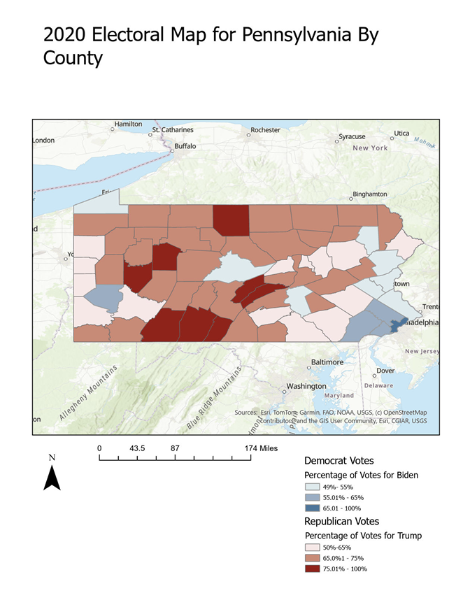
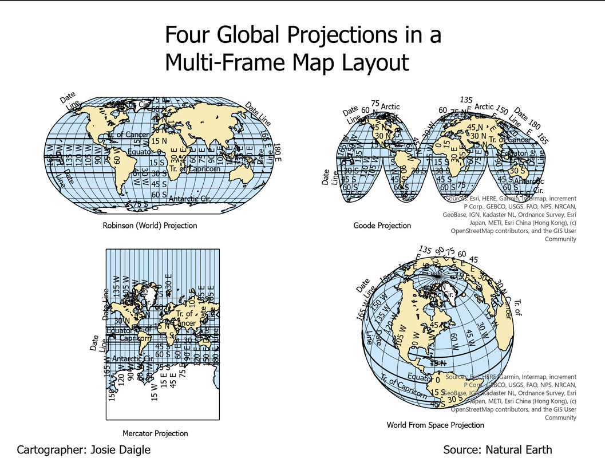
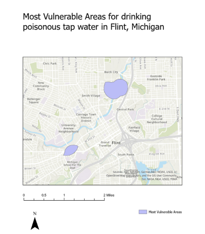

---
title: GIS Projects
nav_order: 3
---

# GIS Projects

A collection of geographic information systems projects exploring political geography, cartography, and environmental vulnerability. These projects demonstrate my experience using ArcGIS Pro to analyze spatial data and communicate geographic patterns through maps.

---

## 2020 Pennsylvania Electoral Map

The above map illustrates the distribution of votes cast by party across Pennsylvania counties during the 2020 presidential election, highlighting the differences in support for Joe Biden (Democrat) and Donald Trump (Republican). The goal of the map was to identify regional voting patterns and show which candidate received the majority of votes in each county, while illustrating the strength of that support. Using a graduated color scheme, counties were categorized as light, medium, or dark red or blue depending on the percentage of votes received by each candidate. The map reveals the geographic variation in political preferences across Pennsylvania, making it easier to identify areas of stronger Republican and Democratic support. By combining county boundaries with election results, the map transforms raw voting data into an accessible visual representation of Pennsylvania's political landscape.

**GIS Skills**
- Joining tables
- Attribute table analysis
- Graduated symbology
- Color visualization
- Map design and layout

---

## Comparing Four Global Map Projections

This map compares four different global map projections: Robinson, Goode Homolosine, Mercator, and the World From Space projection to demonstrate how the Earth's surface is represented differently on a two-dimensional map. These maps explore the distortions associated with different coordinate reference systems and aid in understanding how projection choices affect the appearance, size, and shape of geographic features. By displaying the same geographic data in four separate map frames, the layout makes it easier to identify differences in how each projection represents continents, oceans, and geographic reference lines, addressing the challenge of selecting an appropriate projection for different mapping purposes by highlighting the strengths and limitations of each. It demonstrates that no single projection perfectly represents the Earth and that choosing a projection depends on the intended purpose of the map.

**GIS Skills**
- Coordinate reference systems
- Map symbology
- Graticule creation and display
- Map frames and layouts
- Cartographic design

---

## Flint, Michigan Water Vulnerability Analysis

This map identifies areas of Flint, Michigan, where residents may be at greater risk of exposure to contaminated drinking water based on the proximity of environmental hazards and lead water service lines. The analysis combines three factors: proximity to TRI facilities with water pollution exceeding 10,000 tons, proximity to rivers, and proximity to water service lines identified specifically as lead. By using buffer analysis, the map highlights areas within 0.3 miles of pollution facilities, 0.3 miles of rivers, and 0.2 miles of lead service lines. Combining these geographic factors helps identify locations where multiple environmental risks may overlap and where residents could be more vulnerable to potential drinking water contamination. This map provides a useful starting point for identifying potentially vulnerable communities and prioritizing further investigation.

**GIS Skills**
- Attribute querying and selection
- Buffer analysis
- Dissolve
- Spatial analysis
- Cartographic design
